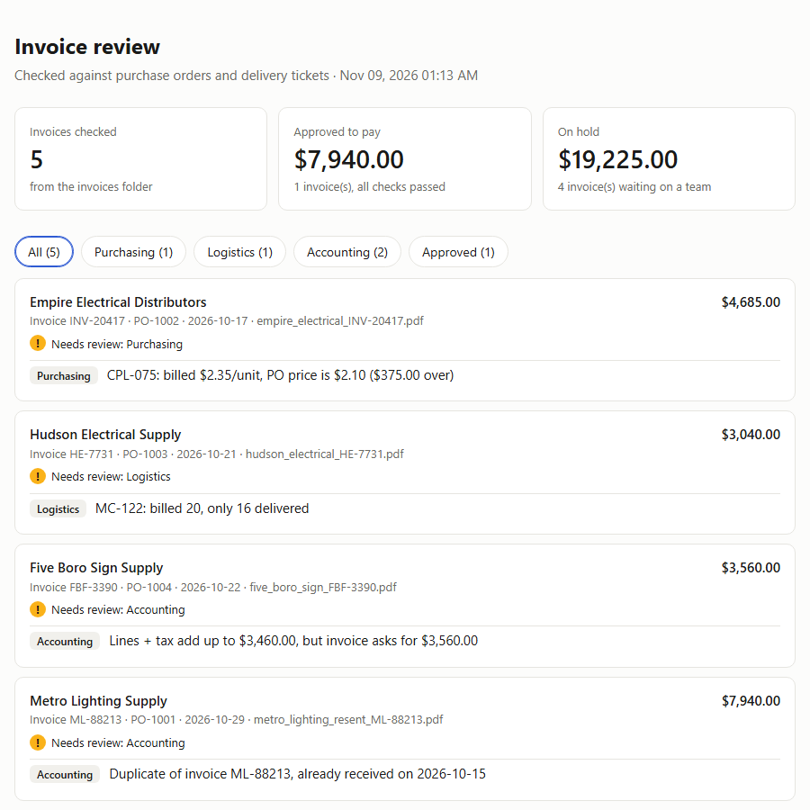

# Invoice Checker

AI reads supplier invoices; plain rules decide what gets paid.

An automated three-way match for contractor invoices. Claude reads vendor PDFs in any layout into structured data, then rule-based checks compare each invoice to its purchase order and delivery ticket. Anything that doesn't match is held and routed to the team that can fix it: Purchasing, Logistics or Accounting.

**[Watch the 5-minute demo](https://www.loom.com/share/decf4c3356a6463d9bc3a10004f79ba3)**



## What it catches

On the 5 sample invoices it approves 1 and holds 4, catching $8,887 in problems:

| Invoice | Problem | Routed to |
|---|---|---|
| Empire Electrical INV-20417 | Billed $2.35/unit, PO price is $2.10 | Purchasing |
| Hudson Electrical HE-7731 | Billed 20, only 16 delivered | Logistics |
| Five Boro Sign FBF-3390 | Lines + tax don't add up to the total | Accounting |
| Metro Lighting ML-88213 (resent) | Duplicate of an invoice already received | Accounting |

All vendors, invoices, purchase orders and deliveries are **fictional sample data** generated by `make_sample_data.py`.

## How it works

1. **Extract** (`extract.py`): Claude reads each PDF and returns data that must match a strict Pydantic schema. Values are copied exactly as printed, so vendor errors get caught instead of silently fixed.
2. **Check** (`check.py`): no AI here. Plain rules compare price, quantity ordered, quantity delivered, math and duplicates, so the same invoice always gets the same answer and every flag has a clear reason.
3. **Report** (`dashboard.py`): builds an HTML review page grouped by team.
4. **Route** (`jira_sync.py`, optional): files each held invoice as a Jira ticket in its team's queue, with no duplicates on re-runs.
5. **Procore** (optional): `procore_seed.py` loads the sample purchase orders into a Procore sandbox, and `check.py --source procore` reads them back through the Procore API.

## Run it

```bash
python -m venv .venv && source .venv/bin/activate   # Windows: .venv\Scripts\activate
pip install -r requirements.txt
export ANTHROPIC_API_KEY=...   # see .env.example; Jira/Procore settings are optional

python make_sample_data.py   # create the fictional POs, deliveries and invoice PDFs
python extract.py            # Claude reads the PDFs  -> extracted/*.json
python check.py              # rule-based checks      -> results.json
python dashboard.py          # review page            -> dashboard.html
```

The `extracted/` folder already contains Claude's output for the sample invoices, so you can run `check.py` and `dashboard.py` without an API key.

## Stack

Python · Claude API · Pydantic · Jira REST API · Procore API
